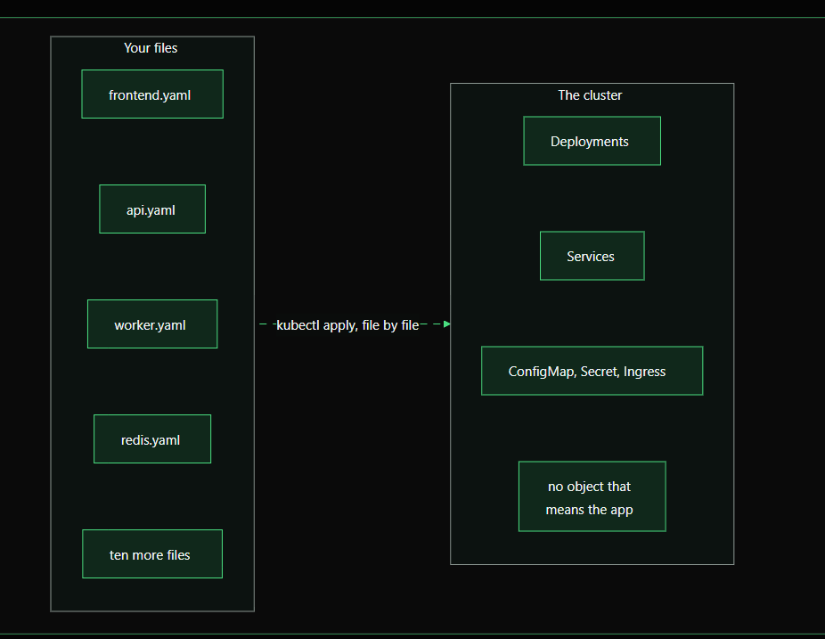

# Why Helm? — Solving Real-World Kubernetes Problems

> **Goal:** Understand why teams use Helm to manage Kubernetes applications before learning how to build Helm charts.

## Overview



*The diagram illustrates the challenge: many separate YAML files create individual Kubernetes objects, but there is no single application-level unit to install, configure, and manage.*

A real-world application rarely consists of a single Kubernetes manifest. It may include a frontend, API, background worker, Redis, Deployments, Services, ConfigMaps, Secrets, and Ingress rules.

Kubernetes can create and manage each of these resources from YAML. However, plain YAML files alone do not provide a convenient application-level unit for packaging, environment-specific configuration, and release history.

**Helm** is a package manager for Kubernetes. It groups related manifests into a **chart**, allows configurable values for different environments, and tracks installed versions as **releases**.

---

## Problem 1: Many files, but no application unit

Imagine a web application with these components:

```text
my-app/
├── frontend.yaml
├── api.yaml
├── worker.yaml
├── redis.yaml
├── services.yaml
├── configmap.yaml
├── secret.yaml
├── ingress.yaml
└── ...more manifests
```

You might apply the files one by one:

```bash
kubectl apply -f frontend.yaml
kubectl apply -f api.yaml
kubectl apply -f worker.yaml
kubectl apply -f redis.yaml
# Apply the remaining manifests too
```

### Why this becomes difficult

- **Installation:** You must remember every required manifest.
- **Maintenance:** Related resources are managed as separate files and commands.
- **Uninstallation:** You must reliably identify and remove all resources belonging to the app.
- **Consistency:** Forgetting a file can leave the application partially configured or leave resources behind.

Kubernetes manages individual objects such as Deployments, Services, and ConfigMaps. It does not automatically treat a folder of YAML files as one installable application.

### How Helm helps

A Helm chart packages the related Kubernetes templates and default configuration into one reusable unit.

```text
my-app/
├── Chart.yaml
├── values.yaml
└── templates/
    ├── frontend-deployment.yaml
    ├── frontend-service.yaml
    ├── api-deployment.yaml
    ├── api-service.yaml
    ├── worker-deployment.yaml
    ├── redis.yaml
    └── ingress.yaml
```

Install or upgrade the chart:

```bash
helm upgrade --install my-app ./my-app
```

Uninstall the release:

```bash
helm uninstall my-app
```

Helm manages the resources rendered by the release. Resources created separately or retained through policies may need separate cleanup.

---

## Problem 2: Copy-paste configuration for each environment

Suppose staging needs one replica and production needs five. The application is otherwise the same.

A copy-paste approach may look like this:

```text
kubernetes/
├── staging/
│   └── deployment.yaml
└── production/
    └── deployment.yaml
```

Staging configuration:

```yaml
replicas: 1
memory: 256Mi
```

Production configuration:

```yaml
replicas: 5
memory: 1Gi
```

If the two directories contain full copies of every manifest, a shared change—such as fixing a readiness probe—must be applied to both. Over time, the copies can drift.

### How Helm helps

Keep the common template in one place and put environment-specific settings in separate values files.

```text
my-app/
├── Chart.yaml
├── values.yaml
├── values-staging.yaml
├── values-production.yaml
└── templates/
    └── deployment.yaml
```

Example `values.yaml`:

```yaml
replicaCount: 1

resources:
  requests:
    memory: 128Mi
  limits:
    memory: 256Mi
```

Example `values-staging.yaml`:

```yaml
replicaCount: 1

resources:
  limits:
    memory: 256Mi
```

Example `values-production.yaml`:

```yaml
replicaCount: 5

resources:
  limits:
    memory: 1Gi
```

The Deployment template references these values rather than hard-coding environment-specific settings:

```yaml
spec:
  replicas: {{ .Values.replicaCount }}
```

Deploy the same chart with different values:

```bash
helm upgrade --install my-app ./my-app \
  --namespace staging \
  --create-namespace \
  -f values-staging.yaml

helm upgrade --install my-app ./my-app \
  --namespace production \
  --create-namespace \
  -f values-production.yaml
```

**Important:** Helm does not automatically guarantee that environments are identical. Teams must manage and review their values files and chart versions carefully.

---

## Problem 3: No convenient release history or rollback workflow

With plain YAML, you might run:

```bash
kubectl apply -f deployment.yaml
```

Kubernetes updates the object, but `kubectl apply` does not create a Helm-style application release with a chart version, supplied values, and release revision.

If a rollout causes an incident, you may need to find the old manifest in Git and reapply it. Kubernetes also has a Deployment rollout history, but that is not the same as release history for an entire application composed of multiple resources.

### How Helm helps

Helm records release revisions and supports release inspection and rollback.

```bash
# Install or upgrade
helm upgrade --install payments ./payments-chart

# See releases in the current namespace
helm list

# Inspect release history
helm history payments

# Inspect release details and configuration
helm get all payments

# Roll back to revision 1
helm rollback payments 1
```

The revision number is an example; check `helm history payments` and select the intended revision.

A rollback is not a universal undo button. External side effects, database migrations, persistent data changes, and resources retained by policy may not be reversed automatically. Test rollback procedures before relying on them during an incident.

---

## The three problems at a glance

| Problem | Plain YAML workflow | Helm capability |
|---|---|---|
| Many resources per application | Apply and track multiple manifests | Package related templates in a chart |
| Different environment settings | Duplicate folders or maintain separate manifests | Reuse templates with values files |
| Release history and rollback | Find old files and reapply them manually | Track release revisions and roll back a release |

---

## Key Helm terminology

| Term | Meaning |
|---|---|
| **Chart** | A package containing Kubernetes templates, default values, and chart metadata |
| **Template** | A Kubernetes manifest containing Helm template expressions |
| **`values.yaml`** | Default configuration values used to render templates |
| **Release** | An installed instance of a chart in a Kubernetes cluster |
| **Revision** | A version of a release recorded by Helm |
| **Repository** | A location where charts can be shared and distributed |

A chart is the package; a release is an installed instance of that chart. The same chart can be installed more than once with different release names, namespaces, or values.

---

## Try it yourself

### 1. Check the tools

```bash
kubectl version --client
helm version
kubectl config current-context
```

Make sure your Kubernetes context points to the intended learning cluster.

### 2. Create a sample chart

```bash
helm create demo-app
cd demo-app
```

Helm generates a starter chart with example templates and values.

### 3. Validate and preview the rendered YAML

```bash
helm lint .
helm template demo-app .
```

`helm template` renders the chart locally. It does not install resources in the cluster.

### 4. Install the chart

```bash
helm upgrade --install demo-app . \
  --namespace helm-lab \
  --create-namespace
```

### 5. Inspect the release

```bash
helm list -n helm-lab
helm status demo-app -n helm-lab
helm history demo-app -n helm-lab
kubectl get all -n helm-lab
```

### 6. Change a value and upgrade

Edit a setting in `values.yaml`, such as the replica count, then run:

```bash
helm upgrade demo-app . -n helm-lab
helm history demo-app -n helm-lab
```

Check whether a new revision was recorded.

### 7. Roll back and clean up

```bash
helm rollback demo-app 1 -n helm-lab
helm history demo-app -n helm-lab

# Remove the learning release when finished
helm uninstall demo-app -n helm-lab
```

If you changed the chart or made additional revisions, choose the appropriate revision from the history instead of assuming revision `1` is always the right target.

---

## What Helm does not replace

Helm builds on Kubernetes; it does not replace it.

- Kubernetes still schedules containers and reconciles resources.
- Helm renders templates and manages chart releases.
- Git still provides source control and code review for your chart and values.
- A CI/CD or GitOps tool can automate deployment of reviewed chart versions.
- Secrets require careful handling. Do not commit real credentials in plain-text values files. Consider your platform's secret-management solution and avoid exposing rendered secrets in logs or command output.

## Final takeaway

The core reason to learn Helm is **repeatable application delivery**:

1. **Package** related Kubernetes resources into a chart.
2. **Configure** the same chart for staging, production, and other environments.
3. **Track** releases and use history to support upgrades and rollback.

YAML remains the foundation. Helm adds a reusable packaging, configuration, and release-management layer on top of it.

## Further reading

- [Helm documentation](https://helm.sh/docs/)
- [Helm Charts](https://helm.sh/docs/topics/charts/)
- [Helm Values](https://helm.sh/docs/chart_template_guide/values_files/)
- [Helm Upgrade](https://helm.sh/docs/helm/helm_upgrade/)
- [Helm Rollback](https://helm.sh/docs/helm/helm_rollback/)
