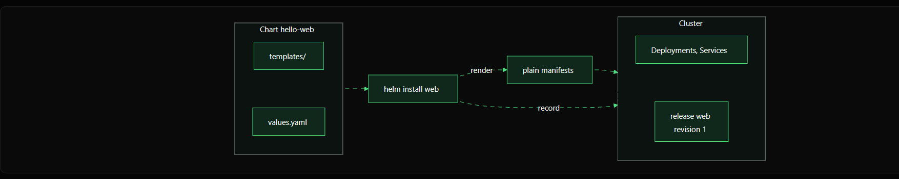

# Chapter 2: What Is Helm?

Helm is the **package manager for Kubernetes**. It helps you install, upgrade, roll back, and remove an application without managing every Kubernetes YAML file separately.

## 1. Think of Helm like a software package manager

On a Linux machine, you might install software using a package manager instead of manually copying every file.

Helm does a similar job for Kubernetes:

- **Chart:** The package containing templates and configuration.
- **Values:** Settings that can change between environments.
- **Release:** An installed instance of a chart in a Kubernetes cluster.
- **Revision:** A numbered version of a release.

A chart is the package you provide to Helm. A release is what Helm records after that chart is installed.

## 2. How an installation works



The flow is:

1. You create a chart folder, for example `hello-web/`.
2. The chart contains templates and a `values.yaml` file.
3. Helm reads the chart and fills the templates with the configured values.
4. Helm renders ordinary Kubernetes YAML manifests.
5. Helm sends those manifests to the Kubernetes API server.
6. Helm records the installed application as a release, such as `web`, with a revision number.

The diagram is a simplified view. Helm's release record is stored in the cluster, while the Helm CLI runs on your computer or in your deployment environment.

## 3. What does a chart look like?

A small chart might have this structure:

```text
hello-web/
├── Chart.yaml
├── values.yaml
└── templates/
    ├── deployment.yaml
    └── service.yaml
```

- `Chart.yaml` describes the chart, including its name and version.
- `values.yaml` contains default settings.
- `templates/` contains Kubernetes YAML templates that Helm renders.

For example, `values.yaml` might contain:

```yaml
replicaCount: 2
image:
  repository: nginx
  tag: "1.27"
```

A Deployment template can use the replica setting like this:

```yaml
spec:
  replicas: {{ .Values.replicaCount }}
```

When Helm renders the template, it replaces `{{ .Values.replicaCount }}` with `2`, producing ordinary Kubernetes YAML.

## 4. Installing a chart

Once the `hello-web` chart exists, install it with:

```bash
helm install web ./hello-web
```

Here:

- `helm install` tells Helm to install a chart.
- `web` is the **release name**.
- `./hello-web` is the path to the chart directory.

**Important:** This command will fail if the `./hello-web` chart directory does not exist or is not a valid chart. In this lesson, it illustrates the command format; you will create the chart in a later hands-on exercise.

To see releases in the current namespace:

```bash
helm list
```

To inspect the release:

```bash
helm status web
helm history web
```

To upgrade it after changing the chart:

```bash
helm upgrade web ./hello-web
```

To roll back to a previous revision, first check `helm history web`, then use the revision you want:

```bash
helm rollback web 1
```

To uninstall the release:

```bash
helm uninstall web
```

The revision `1` is only an example. Choose a revision that actually appears in your release history.

## 5. Does Helm need to run inside Kubernetes?

**No.** The `helm` CLI normally runs on your computer or in a CI/CD pipeline. It uses your Kubernetes configuration (kubeconfig) to connect to the cluster's API server, similar to `kubectl`.

Check whether your current context can reach the cluster:

```bash
kubectl get nodes
```

If this command succeeds, Helm can generally use the same context, provided it is installed and has the necessary permissions. A successful `kubectl` command does not guarantee Helm has every permission it needs, but both tools use the same Kubernetes access configuration by default.

## 6. Connect this to the previous lesson

| Earlier problem | How Helm helps |
|---|---|
| Many YAML files with no single application package | A chart groups related templates and configuration |
| Separate copies for staging and production | Values let you configure the same chart differently |
| Difficult manual recovery after changes | Release history supports inspection and rollback |

## Key takeaway

Remember these three terms:

**Chart = package** · **Release = installed instance** · **Revision = release version**

Helm does not replace Kubernetes or YAML. It makes Kubernetes applications easier to package, configure, install, upgrade, and roll back.

## Next lesson

Next, learn the three core Helm concepts in more detail: **charts, releases, and repositories**.

## Official documentation

- [Helm documentation](https://helm.sh/docs/)
- [Charts](https://helm.sh/docs/topics/charts/)
- [Values files](https://helm.sh/docs/chart_template_guide/values_files/)
- [Helm install](https://helm.sh/docs/helm/helm_install/)
- [Helm upgrade](https://helm.sh/docs/helm/helm_upgrade/)
- [Helm rollback](https://helm.sh/docs/helm/helm_rollback/)
