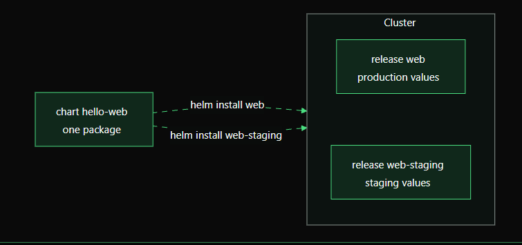

# Chapter 3: Charts, Releases, and Repositories

Helm has three important building blocks:

- **Chart = the package**
- **Release = one installed copy**
- **Repository = a place that stores and shares charts**

Let's understand each one with a simple example.

## 1. Chart: the package

A **chart** is a folder (or a packaged `.tgz` file) that describes a Kubernetes application. It usually contains:

```text
hello-web/
├── Chart.yaml       # Chart name, version, and metadata
├── values.yaml      # Default configuration
└── templates/       # Kubernetes YAML templates
    ├── deployment.yaml
    ├── service.yaml
    └── ingress.yaml
```

Think of a chart like a recipe or a software package. It describes what Helm should create, but **nothing gets installed just because the chart exists**.

## 2. Release: one installed copy

When you install a chart, Helm creates a **release**. A release has a name that you choose.

For example:

```bash
helm install web ./hello-web
```

This installs the local chart `./hello-web` as a release named `web`.

> This command is an example. It will work only after you have created a valid `hello-web` chart and have access to a Kubernetes cluster.

The chart name and release name are different things:

- `hello-web` is the chart directory.
- `web` is the release name chosen for this installation.

### One chart, multiple releases

You can install the same chart more than once in the same cluster using different release names and configuration values.



Production example:

```bash
helm install web ./hello-web \
  --namespace production \
  --create-namespace \
  -f values-production.yaml
```

Staging example:

```bash
helm install web-staging ./hello-web \
  --namespace staging \
  --create-namespace \
  -f values-staging.yaml
```

Both releases use the same chart, but each can have different settings. The example uses separate namespaces to keep production and staging resources isolated.

## 3. Repository: a place to share charts

A **Helm repository** stores packaged charts so teams can share and install them without passing folders around manually. Traditional Helm chart repositories are served over HTTP and use an index; charts can also be distributed through OCI registries.

In this chapter, we use a chart stored locally on disk, such as `./hello-web`. Repositories will be covered later.

Keep the distinction clear:

- A chart describes an application.
- A release is an installed instance of a chart.
- A repository stores and distributes charts; it does not store your running application releases.

## 4. Useful Helm commands

```bash
# Install a chart as a named release
helm install web ./hello-web

# List releases in the current namespace
helm list

# Inspect a release
helm status web

# View release revision history
helm history web

# Upgrade a release after changing the chart
helm upgrade web ./hello-web

# Roll back to a revision shown by helm history
helm rollback web 1

# Uninstall a release
helm uninstall web
```

Revision `1` is just an example. Check `helm history web` and choose the revision you actually want to restore. These commands assume the release is in the current namespace; add `-n <namespace>` when needed.

## 5. Quick comparison

| Term | Simple meaning | Example |
|---|---|---|
| Chart | Package / application blueprint | `./hello-web` |
| Release | Installed copy of a chart | `web`, `web-staging` |
| Repository | Place that shares packaged charts | A chart repository or OCI registry |

## Key takeaway

**One chart can create many releases.** For example, you can use the same `hello-web` chart for production and staging, changing only the values for each environment. Repositories make charts easier to share across a team.

Next, verify that your Helm CLI works and can connect to your Kubernetes cluster:

```bash
helm version
kubectl get nodes
```

If `kubectl get nodes` succeeds, Helm can generally use the same Kubernetes context, provided Helm is installed and has the required permissions.

## Official documentation

- [Helm documentation](https://helm.sh/docs/)
- [Charts](https://helm.sh/docs/topics/charts/)
- [Helm repositories](https://helm.sh/docs/topics/chart_repository/)
- [Helm install](https://helm.sh/docs/helm/helm_install/)
