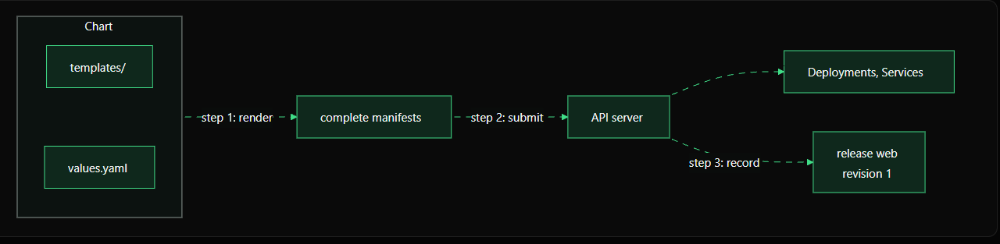

# Day 2 — Chapter 1: What Happens When You Run `helm install`?

> **Goal:** Understand the three things Helm does during an installation: render templates, submit Kubernetes manifests, and record a release.

## The command

```bash
helm install NAME CHART
```

- **`NAME`** is the release name you choose.
- **`CHART`** is the chart location. In this course, use a local chart path.

Example:

```bash
helm install web /root/charts/hello-web
```

This example works only if the chart exists at `/root/charts/hello-web` and your Helm CLI can connect to a Kubernetes cluster.

## Installation flow



Helm performs three main steps.

### Step 1 — Render the templates

A chart contains Kubernetes templates in its `templates/` directory. They look like YAML, but can contain placeholders such as:

```yaml
spec:
  replicas: {{ .Values.replicaCount }}
```

Helm reads the chart's default `values.yaml` and any values you override, then replaces template expressions with their actual values. The result is ordinary Kubernetes YAML.

Preview the rendered YAML without installing anything:

```bash
helm template web /root/charts/hello-web
```

`helm template` renders locally; it does not create a release or submit the rendered resources to the cluster.

### Step 2 — Submit the manifests to Kubernetes

During an install, Helm sends the rendered resources to the Kubernetes API server. Kubernetes then manages the resulting objects, such as Deployments and Services.

You can inspect those objects with `kubectl`, for example:

```bash
kubectl get deployments,services
```

Use the correct namespace if your release was installed outside the current namespace:

```bash
kubectl get deployments,services -n production
```

### Step 3 — Record the release

Helm stores release information in the cluster, including the release name, revision, chart, and configuration. The first successful installation normally creates revision `1`.

This record is important because it lets Helm show releases, inspect history, upgrade them, and roll back to a previous revision.

Useful commands:

```bash
helm list
helm status web
helm history web
```

These commands assume the release is in the current namespace. Add `-n <namespace>` when needed.

## Why does this matter?

With raw YAML, you can create Kubernetes objects using `kubectl apply`, but you do not get Helm's chart-based release history and workflow. Helm combines templating and installation with a tracked release.

Remember the flow:

1. **Render** — templates become complete YAML manifests.
2. **Submit** — Helm sends the manifests to the Kubernetes API server.
3. **Record** — Helm stores a release record and revision.

When installation succeeds, Helm prints a summary including the release name, namespace, status, and revision. The expected status is usually `deployed`.

## Quick practice

Run these commands against a chart that already exists in your environment:

```bash
helm version
kubectl get nodes
helm lint /root/charts/hello-web
helm template web /root/charts/hello-web
helm install web /root/charts/hello-web
helm status web
helm history web
kubectl get deployments,services
```

If the release name `web` already exists in that namespace, choose a different name or inspect the existing release before proceeding.

## Suggested hands-on labs

Complete the labs in [`labs/README.md`](labs/README.md).

## Key takeaway

**One `helm install` command renders a chart, submits its resources to Kubernetes, and records a named release.** The release record is what makes Helm's upgrade and rollback workflow possible.

## Official documentation

- [Helm install](https://helm.sh/docs/helm/helm_install/)
- [Helm template](https://helm.sh/docs/helm/helm_template/)
- [Helm chart templates](https://helm.sh/docs/chart_template_guide/)
- [Helm release history](https://helm.sh/docs/helm/helm_history/)
