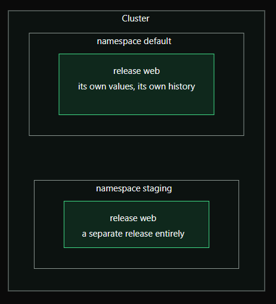

# Day 2 — Chapter 2: Release Names and Namespaces

> **Goal:** Learn why a Helm release name must be unique within a namespace, and how namespaces let you install the same release name more than once in a cluster.

## 1. One release name per namespace

Imagine you already installed a release named `web` in the `default` namespace:

```bash
helm install web /root/charts/hello-web
```

If you run the same command again in the same namespace, Helm refuses because the release name is already in use.

A release name identifies one Helm-managed installation. Helm needs the name to be unique within that namespace so it can track the correct release and its history.

## 2. The same name can be used in another namespace

A namespace is like a separate workspace inside a Kubernetes cluster. Helm tracks releases within namespaces, so the release name `web` can exist in `default` and also in `staging`.



These are separate releases. They can have different values and different revision histories, and their Kubernetes resources are created in their respective namespaces.

## 3. Choose a namespace with `-n`

Use `-n` (short for `--namespace`) to install into a specific namespace:

```bash
helm install web /root/charts/hello-web -n staging
```

The chart path must exist, and the `staging` namespace must already exist for this command to work.

Helm commands can use the same namespace option:

```bash
helm list -n staging
helm status web -n staging
helm history web -n staging
```

To list releases across all namespaces:

```bash
helm list -A
```

## 4. Let Helm create the namespace

If the namespace might not exist yet, add `--create-namespace`:

```bash
helm install web /root/charts/hello-web \
  --namespace staging \
  --create-namespace
```

Helm creates the namespace if it is missing, then installs the chart there. If the namespace already exists, it is reused.

## 5. Hands-on example

Assuming your chart is available at `/root/charts/hello-web`, install a release in `default` (omit `-n` only if your current context defaults to `default`):

```bash
helm install web /root/charts/hello-web
```

Then install the same chart as `web` in `staging`:

```bash
helm install web /root/charts/hello-web \
  --namespace staging \
  --create-namespace
```

Inspect both releases:

```bash
helm list -n default
helm list -n staging
helm list -A
```

If a release named `web` already exists in `default`, do not reinstall it; inspect it with `helm status web -n default` instead.

## Key takeaway

- **Release name:** Identifies one installed chart instance.
- **Namespace:** Separates groups of Kubernetes resources and Helm releases.
- **Same name, same namespace:** Not allowed when the name is already in use.
- **Same name, different namespaces:** Allowed, because each is a separate release.

This is a common way to keep staging and production workloads separate while reusing the same chart.


## 6. See what Helm created

A Helm release is not a black box. The Deployments, Services, and other resources created by a chart are ordinary Kubernetes objects. You can inspect them with `kubectl`.

For this exercise, inspect the release named `web` in the `default` namespace.

### Find the Deployment and Service

List the resources and their names:

```bash
kubectl get deployments,services -n default
```

To find resources labelled for the `web` release:

```bash
kubectl get deployments,services \
  -n default \
  -l app.kubernetes.io/instance=web
```

Write the Deployment and Service names to `/root/answers/web-resources.txt`, one name per line. First create the answer directory:

```bash
mkdir -p /root/answers
```

For a chart that uses the standard release labels, you can generate the file with:

```bash
{
  kubectl get deployments -n default \
    -l app.kubernetes.io/instance=web \
    -o name
  kubectl get services -n default \
    -l app.kubernetes.io/instance=web \
    -o name
} | sed 's#^[^/]*/##' > /root/answers/web-resources.txt
```

Review the output:

```bash
cat /root/answers/web-resources.txt
```

The file should contain the actual Deployment name and Service name, one per line. If your chart does not apply the standard labels, use `kubectl get deployments,services -n default` to identify the names manually.

### Save the Deployment labels

The labels `app.kubernetes.io/name` and `app.kubernetes.io/instance` are commonly used by charts to identify an application and a particular installed release. The instance label should be `web`.

```bash
kubectl get deployment <deployment-name> \
  -n default \
  -o jsonpath='{.metadata.labels}' \
  > /root/answers/web-labels.txt
```

Replace `<deployment-name>` with the Deployment name you found. Check the saved output:

```bash
cat /root/answers/web-labels.txt
```

Confirm that the output includes `app.kubernetes.io/instance` with the value `web`. If you need to query only the two expected labels, use:

```bash
kubectl get deployment <deployment-name> \
  -n default \
  -o jsonpath='{.metadata.labels.app\.kubernetes\.io/name}{" "}{.metadata.labels.app\.kubernetes\.io/instance}{"\n"}' \
  > /root/answers/web-labels.txt
```

This second command writes the application name and release instance values in a compact form. Use the full-labels command if the exercise requires the complete metadata labels.

**Why this matters:** During an incident, labels help you trace a Kubernetes object back to the release that created it. Labels are useful identification metadata; they are not, by themselves, a security boundary.

## Suggested hands-on labs

Complete the exercises in [`labs/README.md`](labs/README.md).

## Official documentation

- [Helm install](https://helm.sh/docs/helm/helm_install/)
- [Helm list](https://helm.sh/docs/helm/helm_list/)
- [Kubernetes Namespaces](https://kubernetes.io/docs/concepts/overview/working-with-objects/namespaces/)
