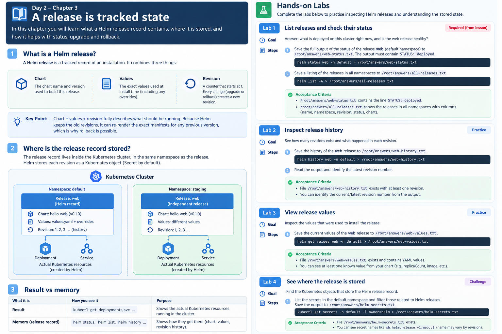

# Day 2 — Chapter 3: A Release Is Tracked State

> **Goal:** Understand what a Helm release record contains, where Helm stores it, and how that record supports inspection, upgrades, and rollback.

## 1. What is a Helm release?

A Helm release is the tracked record of one installation of a chart. It brings together three important things:

| Part | Simple meaning |
|---|---|
| **Chart** | The chart name and version used for the installation |
| **Values** | The configuration used, including overrides supplied at install or upgrade time |
| **Revision** | The numbered history of changes to the release |

The first successful install normally creates revision `1`. A later upgrade creates another revision. A rollback also creates a new revision that restores an earlier release configuration; it does not erase the history.

Think of the release record as Helm's memory of how the application was configured at each revision.

## 2. Why does the release record matter?

Suppose revision 2 works, but revision 3 causes a problem. Helm can use the earlier revision's recorded chart and configuration to perform a rollback.

That is why commands such as these are useful:

```bash
helm list
helm status web
helm history web
helm get values web
helm get manifest web
```

Add `-n <namespace>` if the release is not in your current namespace.

## 3. Where is the release record stored?

The release record is stored **inside the Kubernetes cluster**, in the namespace where the release is installed. With Helm 3's default storage driver, release records are stored as Kubernetes Secrets. Other storage drivers can be configured.

This means the release is not saved only on the laptop that ran the installation. Another authorized operator or CI/CD job can inspect the same release by connecting to the same cluster with appropriate permissions.



## 4. Result versus memory

Keep this distinction clear:

| Concept | What it means | Useful commands |
|---|---|---|
| **Result** | The actual Kubernetes resources created by the chart | `kubectl get deployments,services,pods` |
| **Memory** | Helm's record of the chart, values, and release revisions | `helm status`, `helm history`, `helm get values` |

`kubectl` shows you the resources currently in the cluster. Helm's release commands show you the tracked installation and its history.

## 5. Required task — List releases and check status

A teammate asks: “What is deployed on this cluster, and is the `web` release healthy?”

Create the answer directory:

```bash
mkdir -p /root/answers
```

Save the full status output for the `web` release in the `default` namespace:

```bash
helm status web -n default > /root/answers/web-status.txt
```

The saved file must contain:

```text
STATUS: deployed
```

Now save a listing of releases across **all namespaces**:

```bash
helm list -A > /root/answers/all-releases.txt
```

Read both files before submitting:

```bash
cat /root/answers/web-status.txt
cat /root/answers/all-releases.txt
```

The all-namespaces listing includes useful columns such as release name, namespace, revision, status, and chart. If the `web` release is not in `default` or its status is not `deployed`, investigate rather than editing the output manually.

## Key takeaway

A Helm release record is the history and configuration memory for an installed chart. The Kubernetes resources are the result; the release record helps Helm explain, inspect, upgrade, and roll back that result.

## Suggested hands-on labs

Complete the exercises in [`labs/README.md`](labs/README.md).

## Official documentation

- [Helm status](https://helm.sh/docs/helm/helm_status/)
- [Helm list](https://helm.sh/docs/helm/helm_list/)
- [Helm history](https://helm.sh/docs/helm/helm_history/)
- [Helm get values](https://helm.sh/docs/helm/helm_get_values/)
- [Helm storage backends](https://helm.sh/docs/topics/advanced/#storage-backends)
