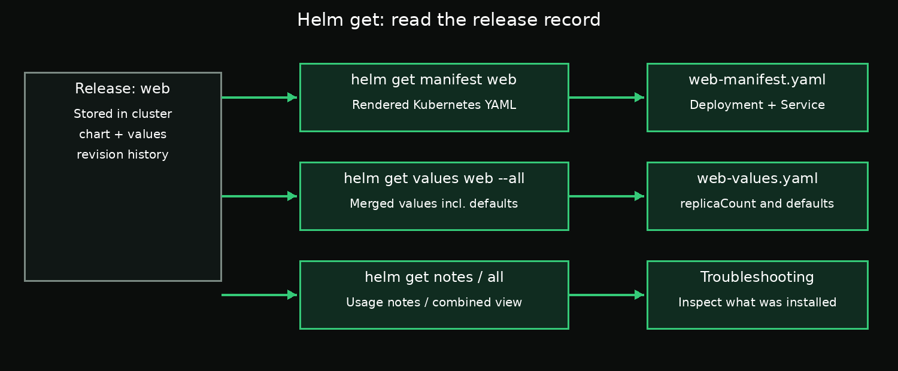

# Day 2 — Chapter 4: Read a Release Back with `helm get`

> **Goal:** Learn how to inspect the exact manifests, values, and notes stored for a Helm release.

## Why use `helm get`?

`helm status` tells you the release status and basic details. When an application behaves unexpectedly, you often need to inspect the configuration Helm recorded for that installation.

`helm get` reads information from the release record stored in the cluster.



## 1. What YAML did Helm render?

```bash
helm get manifest web -n default
```

This prints the rendered Kubernetes manifests stored for the `web` release, such as its Deployment and Service. These are the manifests associated with the release revision Helm is currently showing.

Save them to a file:

```bash
helm get manifest web -n default > /root/answers/web-manifest.yaml
```

Inspect the file:

```bash
cat /root/answers/web-manifest.yaml
```

## 2. What values were supplied?

```bash
helm get values web -n default
```

Without extra flags, this shows user-supplied values for the release. If no overrides were supplied, the output may be empty or `null`.

To see the computed values, including chart defaults:

```bash
helm get values web -n default --all
```

Save the merged values:

```bash
helm get values web -n default --all > /root/answers/web-values.yaml
```

Inspect the result:

```bash
cat /root/answers/web-values.yaml
```

For this lesson, confirm the output contains the `replicaCount` setting. If it does not, check whether the chart uses that value name and whether the correct release and namespace were selected.

## 3. Read chart notes

Some charts provide usage instructions in their notes after installation. You can view them again with:

```bash
helm get notes web -n default
```

Notes are authored by the chart; not every chart provides useful notes.

## 4. Get the combined release information

```bash
helm get all web -n default
```

This combines several pieces of release information, including notes, values, manifests, and metadata. It can be useful when gathering evidence before a risky change. Be careful when sharing the output: values or rendered manifests may contain sensitive configuration.

## 5. Result versus recorded configuration

- `kubectl get` shows the current Kubernetes objects.
- `helm get manifest` shows the manifests recorded for the release.
- `helm get values --all` shows the computed values for the release.
- `helm history` shows the revisions recorded by Helm.

The live cluster can drift after installation, so the Helm-stored manifest and current live object may not always match exactly.

## Required task

Create the answer directory:

```bash
mkdir -p /root/answers
```

Save the fully rendered manifest:

```bash
helm get manifest web -n default > /root/answers/web-manifest.yaml
```

Save merged values, including chart defaults:

```bash
helm get values web -n default --all > /root/answers/web-values.yaml
```

Check both files:

```bash
cat /root/answers/web-manifest.yaml
cat /root/answers/web-values.yaml
```

### Acceptance criteria

- `/root/answers/web-manifest.yaml` contains the release's Deployment and Service manifests.
- `/root/answers/web-values.yaml` contains computed values, including `replicaCount`.
- You used `--all` for the values file rather than saving only user-supplied overrides.

## Key takeaway

Use `helm get manifest` to see the YAML stored for a release, `helm get values --all` to see the computed configuration, and `helm get notes` to retrieve chart-provided instructions.

## Suggested labs

Continue with [`labs/README.md`](labs/README.md).

## Official documentation

- [Helm get](https://helm.sh/docs/helm/helm_get/)
- [Helm get manifest](https://helm.sh/docs/helm/helm_get_manifest/)
- [Helm get values](https://helm.sh/docs/helm/helm_get_values/)
- [Helm get notes](https://helm.sh/docs/helm/helm_get_notes/)
