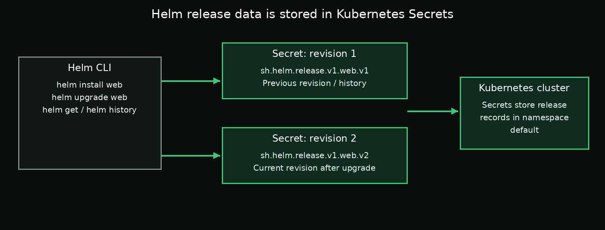

# Day 2 — Chapter 5: Where Helm Stores Release Data

> **Goal:** Discover where Helm stores release history and learn how to inspect the storage object safely.

## 1. Helm stores release records in Kubernetes

With Helm 3's default storage driver, release records are stored as Kubernetes Secrets in the namespace where each release is installed. Helm does not need a separate server-side agent.



## 2. One Secret per revision

A release normally has one storage Secret for each saved revision. The default naming pattern is:

```text
sh.helm.release.v1.RELEASE_NAME.vREVISION
```

For example, revision 1 of a release named `web` in the `default` namespace is commonly stored as:

```text
sh.helm.release.v1.web.v1
```

After an upgrade, a later Secret such as `sh.helm.release.v1.web.v2` may be created. Older revision records are retained according to Helm's history settings and cleanup behavior.

The Secret type is typically:

```text
helm.sh/release.v1
```

Always inspect the object to verify its actual name and type rather than assuming them.

## 3. Find the Secret with kubectl

First confirm that the release exists:

```bash
helm list -n default
helm status web -n default
```

List Secrets associated with Helm's default storage labels:

```bash
kubectl get secrets -n default -l owner=helm,name=web
```

To find the exact Secret for revision 1, query by the expected name:

```bash
kubectl get secret sh.helm.release.v1.web.v1 -n default
```

Read the type from the Kubernetes object:

```bash
kubectl get secret sh.helm.release.v1.web.v1 \
  -n default \
  -o jsonpath='{.type}{"\n"}'
```

Describe the Secret without printing its encoded data:

```bash
kubectl describe secret sh.helm.release.v1.web.v1 -n default
```

If the expected Secret name is not found, list the Helm Secrets and verify the release name, namespace, revision, and configured Helm storage driver.

## 4. Why not read the Secret data directly?

Helm stores the release record in the Secret's data in an encoded/compressed representation. `kubectl describe` shows useful metadata, but it does not turn the stored release record into readable chart values and manifests.

Use Helm's commands to inspect the release:

```bash
helm get manifest web -n default
helm get values web -n default --all
helm history web -n default
```

Avoid decoding or sharing release Secret data unnecessarily. Release records can include configuration that should be treated as sensitive.

## 5. Why this matters to SREs

- **Namespace scope:** The release Secret lives in the release namespace.
- **RBAC:** Helm operations may fail if the user lacks permissions to read or create the required Secrets.
- **Separate storage and workload:** Deleting a release Secret can make Helm lose its tracking record while the Deployment and Service may continue running.
- **History protection:** Cleanup scripts that delete Secrets indiscriminately can damage Helm's release history.

> **Warning:** Do not delete `sh.helm.release.v1.*` Secrets as a cleanup shortcut. Use `helm uninstall` when you intend to uninstall a release.

## Required task

Complete the step-by-step instructions in [`labs/README.md`](labs/README.md). You must save the Secret name and the actual Secret type into the two required answer files.

## Key takeaway

Helm's release record is stored in the cluster. With the default Helm 3 storage driver, each release revision is represented by a Kubernetes Secret in the release namespace. Use `kubectl` to inspect its metadata and `helm get` to inspect the recorded release content.

## Official documentation

- [Helm storage backends](https://helm.sh/docs/topics/advanced/#storage-backends)
- [kubectl get](https://kubernetes.io/docs/reference/kubectl/generated/kubectl_get/)
- [kubectl describe](https://kubernetes.io/docs/reference/kubectl/generated/kubectl_describe/)
