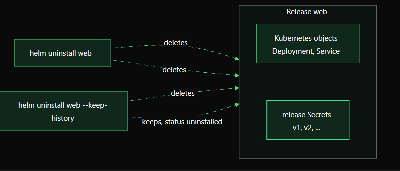

# Day 3 — Chapter 1: Uninstall a Helm Release

> **Goal:** Learn what Helm removes during uninstall, and when to keep release history.

## 1. The command

```bash
helm uninstall NAME
```

For example:

```bash
helm uninstall web
```

Use `-n <namespace>` when the release is not in your current namespace. Only uninstall releases you intend to remove.

## 2. What does Helm remove?

A Helm release has two parts to think about:

1. **Kubernetes resources** — Deployments, Services, ConfigMaps, and other objects included in the release.
2. **Helm release records** — the history Helm stores so it can track installs and revisions.

A normal uninstall removes the release's chart-managed resources and, by default, its release history.



## 3. Remove the app but keep its history

Sometimes the workload must be removed, but the release record should remain for troubleshooting or audit purposes:

```bash
helm uninstall web --keep-history
```

The Kubernetes resources are still removed, but Helm retains the release history and marks the release as `uninstalled`.

Use a namespace when needed:

```bash
helm uninstall web -n staging --keep-history
```

A retained release name may still be considered in use. Check its state before attempting to reuse the name.

## 4. List deployed and uninstalled releases

```bash
helm list --deployed
helm list --uninstalled
helm list -A
```

Use `helm list --uninstalled` to specifically view releases whose history was retained. The display behavior of a plain `helm list` can vary by Helm version and flags.

## 5. Verify before and after uninstall

Before uninstalling:

```bash
helm status web -n default
helm get manifest web -n default
kubectl get deployments,services -n default
```

After a normal uninstall:

```bash
helm list -n default
kubectl get deployments,services -n default
```

After an uninstall that keeps history:

```bash
helm list --uninstalled -n default
helm history web -n default
```

Use separate test releases to practise the two behaviors: a normal uninstall removes history, so it cannot then be used to demonstrate retained history.

## 6. Which option should you choose?

| Command | Kubernetes resources | Release history |
|---|---|---|
| `helm uninstall web` | Removed | Removed by default |
| `helm uninstall web --keep-history` | Removed | Retained; status becomes `uninstalled` |

**SRE tip:** Retain history when it is useful for investigation or audit. Follow your team's change-management and retention policies.

## Suggested hands-on labs

Follow [`labs/README.md`](labs/README.md) for beginner-friendly exercises.

## Key takeaway

A normal uninstall means **remove the app and forget the release history**. With `--keep-history`, Helm **removes the app but remembers the release**.

## Official documentation

- [Helm uninstall](https://helm.sh/docs/helm/helm_uninstall/)
- [Helm list](https://helm.sh/docs/helm/helm_list/)
- [Helm history](https://helm.sh/docs/helm/helm_history/)
