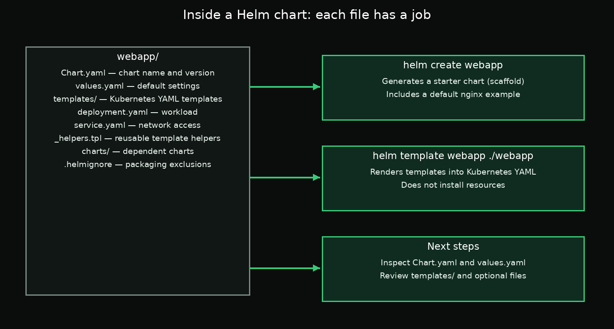

# Day 3 — Chapter 2: Inside a Helm Chart Directory

> **Goal:** Understand the standard chart folder layout and create your own starter chart with `helm create`.

## 1. What makes a folder a Helm chart?

A Helm chart is a folder with a defined structure. The key file is `Chart.yaml`: it describes the chart, including its name and version. Helm expects this file when working with a chart directory.

A minimal chart often looks like this:

```text
webapp/
├── Chart.yaml
├── values.yaml
├── charts/
├── templates/
│   ├── deployment.yaml
│   ├── service.yaml
│   └── _helpers.tpl
└── .helmignore
```



## 2. One job per file

| File or directory | Simple purpose |
|---|---|
| `Chart.yaml` | Metadata about the chart, such as its name and version |
| `values.yaml` | Default settings, such as replicas, image, and ports |
| `templates/` | Kubernetes manifests with Helm template expressions |
| `templates/deployment.yaml` | Defines the application's Deployment |
| `templates/service.yaml` | Defines how the application is exposed inside the cluster |
| `templates/_helpers.tpl` | Reusable named template helpers |
| `charts/` | Dependency charts used by this chart |
| `.helmignore` | Files Helm should skip when packaging the chart |

For a simple chart, `charts/` may be empty. The exact files under `templates/` depend on the chart.

## 3. Generate a chart scaffold

You could create every directory and file manually, but Helm can generate a starter chart:

```bash
helm create webapp
```

This creates a `webapp/` directory with a working starter structure. The default scaffold includes an nginx-based example and may include optional templates such as Ingress, autoscaling, and chart tests. You can keep or remove optional files depending on what your lab requires.

A generated scaffold is a starting point, not a guarantee that every optional resource will be enabled in every cluster configuration.

## 4. Inspect the chart

Move into the chart directory:

```bash
cd /root/work/webapp
```

Read the chart metadata and default values:

```bash
cat Chart.yaml
cat values.yaml
```

List the template files:

```bash
find templates -maxdepth 2 -type f | sort
```

You can also check whether Helm recognizes the chart:

```bash
helm lint .
```

Render the chart locally without installing it:

```bash
helm template webapp .
```

`helm template` shows the Kubernetes YAML that the chart produces; it does not install the resources into your cluster.


## 6. Why charts help: many files become one package

Before using a chart, an application may be spread across many separate YAML files. Kubernetes creates the individual objects, but the files themselves do not form one Helm-managed release until you package them into a chart and install that chart.


The chart structure shown earlier gives those resources one reusable package: `Chart.yaml` describes it, `values.yaml` holds defaults, and `templates/` contains the resource templates.

## 5. Required lab task

The detailed step-by-step task is in [`labs/README.md`](labs/README.md). You will create `/root/work/webapp`, remove the generated `templates/tests` directory, and save the remaining template file list to `/root/answers/webapp-templates.txt`.

## Key takeaway

`Chart.yaml` describes the chart, `values.yaml` provides defaults, and `templates/` contains the Kubernetes resource templates. `helm create webapp` generates a scaffold so you can start learning from a real chart rather than building every file by hand.

## Official documentation

- [Helm chart structure](https://helm.sh/docs/topics/charts/)
- [helm create](https://helm.sh/docs/helm/helm_create/)
- [Chart template guide](https://helm.sh/docs/chart_template_guide/)
