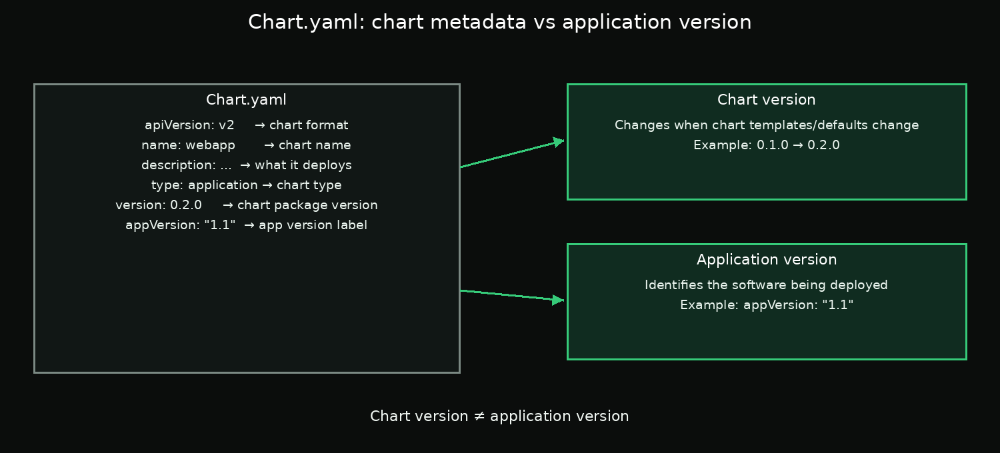

# Day 3 — Chapter 3: Understanding `Chart.yaml`

> **Goal:** Understand the main chart metadata fields and update your `webapp` chart before installing it.

## 1. What is `Chart.yaml`?

`Chart.yaml` is the metadata file that tells Helm about the chart. It includes the chart's name, chart-format version, chart version, and information about the application it packages.

A generated chart may look similar to this:

```yaml
apiVersion: v2
name: webapp
description: A Helm chart for Kubernetes
type: application
version: 0.1.0
appVersion: "1.16.0"
```



## 2. The important fields

| Field | Meaning | Example |
|---|---|---|
| `apiVersion` | Chart metadata format version. `v2` is used by modern Helm charts. | `apiVersion: v2` |
| `name` | The chart's name. It commonly matches the chart directory name. | `name: webapp` |
| `description` | A short sentence describing what the chart deploys. | `description: Deploys an NGINX web server` |
| `type` | Usually `application` for deployable workloads; `library` for reusable helper-only charts. | `type: application` |
| `version` | The version of the chart package itself, conventionally Semantic Versioning. | `version: 0.2.0` |
| `appVersion` | Informational version of the application being packaged. It does not automatically set the image tag. | `appVersion: "1.1"` |

## 3. Chart version vs application version

These two fields sound similar but mean different things:

- **`version`** changes when you update the chart, such as changing templates or default values.
- **`appVersion`** describes the software version the chart is intended to deploy.

For example, you could update a readiness probe and increase the chart version from `0.1.0` to `0.2.0`, while the NGINX application version stays the same.

The `appVersion` field is informational. The container image tag is configured separately in `values.yaml` and the templates. In this lab, you will set the image tag to `alpine` explicitly.

Quote `appVersion` in YAML, especially for values such as `"1.1"`, to preserve the intended string form.

## 4. Update the chart and install it

The lab asks you to make these changes:

- Set `version` to `0.2.0`.
- Set `appVersion` to `"1.1"`.
- Replace the placeholder description with a meaningful sentence.
- Keep `image.repository` as `nginx`.
- Set `image.tag` to `alpine`.
- Install the chart as release `webapp`.

After installation, inspect the release and its pods:

```bash
helm list -n default
helm status webapp -n default
kubectl get pods -n default
```

The chart shown in `helm list` should be `webapp-0.2.0`. Wait for the pod to become Ready before considering the lab complete.

## 5. Suggested validation commands

Check the chart metadata:

```bash
helm show chart /root/work/webapp
```

Check the chart for common issues:

```bash
helm lint /root/work/webapp
```

Preview the rendered manifests without installing:

```bash
helm template webapp /root/work/webapp
```

`helm template` renders the YAML locally; it does not create resources in the cluster.

## Required lab

Follow the step-by-step guide in [`labs/README.md`](labs/README.md).

## Key takeaway

`version` identifies the chart package, while `appVersion` describes the application version. The image tag that Kubernetes actually runs is controlled by the chart's values and templates, so verify it separately.

## Official documentation

- [Helm chart metadata](https://helm.sh/docs/topics/charts/)
- [helm show chart](https://helm.sh/docs/helm/helm_show_chart/)
- [helm install](https://helm.sh/docs/helm/helm_install/)
