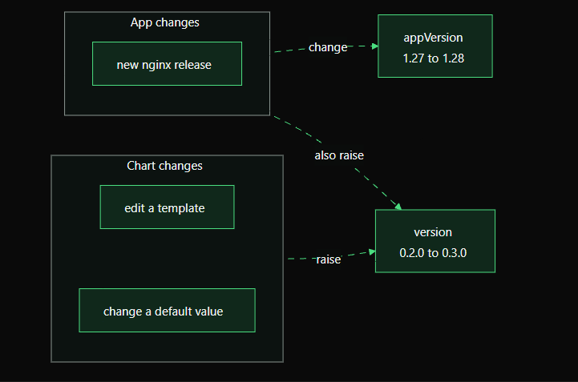
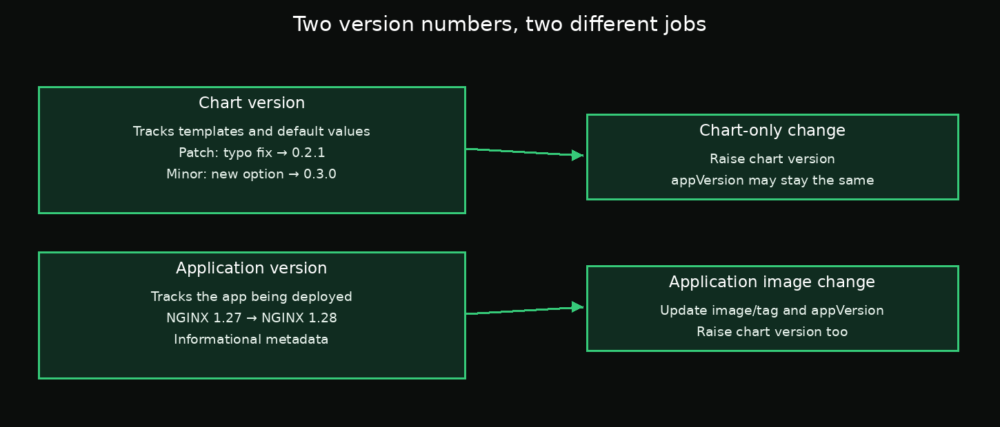

# Day 3 — Chapter 4: Chart Version vs Application Version

> **Goal:** Know when to update `version` and when to update `appVersion`, and why application image changes normally require a chart version change too.

## 1. See both versions

After the previous lab, run:

```bash
helm list -n default
```

The output includes two different columns:

- **CHART** — the chart name and chart version, for example `webapp-0.2.0`.
- **APP VERSION** — the application version recorded in `Chart.yaml`, for example `1.1`.



## 2. `version`: the chart package

The chart `version` tracks the chart itself: its templates, default values, metadata, and configuration interface.

Typical examples:

- Fix a typo or a small template bug: patch version, such as `0.2.0` → `0.2.1`.
- Add a backward-compatible optional setting: minor version, such as `0.2.0` → `0.3.0`.
- Make a breaking change, such as renaming a value that users rely on: major version, such as `0.2.0` → `1.0.0`.

These are common SemVer conventions. Teams should document their own release policy, especially for charts that have not reached `1.0.0`.

## 3. `appVersion`: the application being deployed

`appVersion` describes the application version the chart is intended to deploy. For example, if the chart changes from NGINX 1.27 to NGINX 1.28, update `appVersion` accordingly.

It is informational metadata: **changing `appVersion` alone does not change the container image**. The image repository and tag used by the Deployment come from `values.yaml` and the templates.

## 4. How the two versions work together



| Change | Update `version`? | Update `appVersion`? |
|---|---|---|
| Fix a template typo; same application image | Yes | Usually no |
| Add a new optional chart value; same image | Yes | Usually no |
| Change the default NGINX image from 1.27 to 1.28 | Yes | Yes |
| Change only the informational `appVersion` field, with no real app/image change | Chart metadata changed, so normally yes for a published chart release | Only if it accurately reflects the app |

When the application image changes, you generally update both fields: the app version changes because the software changes, and the chart version changes because the chart's default configuration or rendered output changes.

## 5. Inspect your chart

Show the chart metadata:

```bash
helm show chart /root/work/webapp
```

Check the relevant fields:

```bash
grep -E '^(version|appVersion):' /root/work/webapp/Chart.yaml
```

Check the installed release:

```bash
helm list -n default
helm status webapp -n default
```

Remember that `helm list` reports metadata from the installed release. Editing `Chart.yaml` on disk does not change an already installed release until you upgrade it.

## Suggested hands-on labs

Follow [`labs/README.md`](labs/README.md) for exercises that compare chart-only changes with application image changes.

## Key takeaway

**`version` answers “which chart package?”; `appVersion` answers “which application version?”** If you change the chart's templates or defaults, bump the chart version. If you change the application being deployed, update the app version and usually the chart version as well.

## Official documentation

- [Helm chart metadata](https://helm.sh/docs/topics/charts/)
- [Helm list](https://helm.sh/docs/helm/helm_list/)
- [Helm show chart](https://helm.sh/docs/helm/helm_show_chart/)
