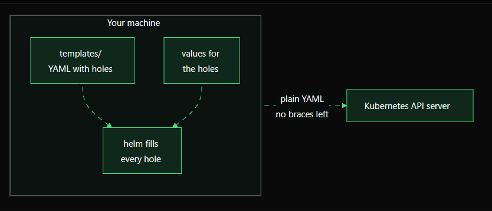
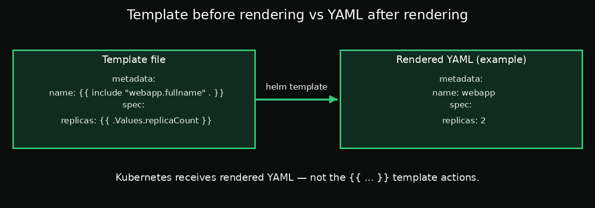

# Chapter 1: Template Basics — How Helm Rendering Works

> **Goal:** Understand how Helm fills template expressions with values and renders ordinary Kubernetes YAML before sending it to the cluster.

## 1. A Helm template is YAML with placeholders

Open `deployment.yaml` inside your chart's `templates/` directory. You may see expressions like these:

```yaml
metadata:
  name: {{ include "webapp.fullname" . }}
spec:
  replicas: {{ .Values.replicaCount }}
```

This is a **Helm template**, not yet the final Kubernetes manifest. The double curly braces `{{ ... }}` contain template actions that Helm evaluates.

## 2. Two kinds of text

- **Outside `{{ ... }}`:** ordinary text, such as YAML keys like `metadata`, `name`, and `replicas`.
- **Inside `{{ ... }}`:** instructions for Helm's Go-based template engine. For example, `.Values.replicaCount` reads a value, while `include "webapp.fullname" .` calls a named helper template.

Think of a template as normal YAML with holes. Helm fills those holes using chart defaults from `values.yaml` and any overrides supplied during the command.



## 3. Rendering happens before Kubernetes receives the YAML

Rendering is the step where Helm evaluates template actions and produces complete manifests. In the normal Helm CLI workflow, this happens in the `helm` client before the manifests are submitted to the Kubernetes API server.

Kubernetes does not process Helm's `{{ ... }}` expressions. It receives the rendered YAML, just as it would receive a hand-written manifest.



For example, if the release name resolves to `webapp` and `replicaCount` is `2`, a rendered portion could look like this:

```yaml
metadata:
  name: webapp
spec:
  replicas: 2
```

The exact name depends on the chart's helper templates and release settings.

## 4. Render without installing

Use `helm template` to preview the output locally:

```bash
helm template myrelease /root/work/webapp
```

This command reads the chart, evaluates its templates with the selected values, and prints the finished Kubernetes manifests. It does **not** install the release or create resources in the cluster.

Save the output for inspection:

```bash
mkdir -p /root/answers
helm template myrelease /root/work/webapp \
  > /root/answers/webapp-rendered.yaml
```

Inspect it:

```bash
less /root/answers/webapp-rendered.yaml
```

Search for unresolved template braces:

```bash
grep -n '{{\|}}' /root/answers/webapp-rendered.yaml
```

No matches is generally expected for ordinary rendered manifests. If a chart intentionally emits literal braces, inspect those cases rather than assuming they are an error.

## 5. Try a values override

Suppose `values.yaml` contains:

```yaml
replicaCount: 1
```

Override the value for a local render:

```bash
helm template myrelease /root/work/webapp \
  --set replicaCount=3
```

Find `replicas: 3` in the rendered Deployment. This demonstrates that Helm uses values to fill templates without modifying `values.yaml` or installing anything.

## Key takeaway

A Helm chart contains templates and values. Helm renders the templates on the client side, and Kubernetes receives the finished YAML—not the template expressions.

## Official documentation

- [Helm template command](https://helm.sh/docs/helm/helm_template/)
- [Helm chart template guide](https://helm.sh/docs/chart_template_guide/)
- [Values files](https://helm.sh/docs/chart_template_guide/values_files/)
