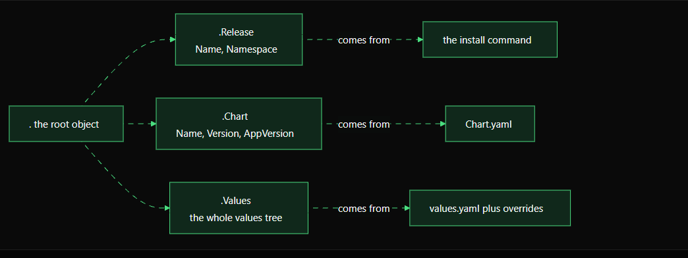
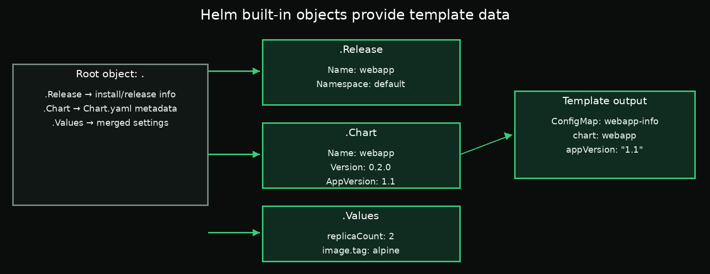

# Chapter 2: Helm Built-in Objects — `Release`, `Chart`, and `Values`

> **Goal:** Learn how templates read release information, chart metadata, and configuration values.

## 1. What is the root object?

When Helm renders a template, it provides a root object containing information about the release, chart, and values. The root object is represented by a dot (`.`).

For example, `.Release.Name` means: start at the root object, access `Release`, then read its `Name` field.



## 2. The three built-in objects

### `.Release` — information about this installation

Common fields include:

- `.Release.Name` — the release name provided to Helm.
- `.Release.Namespace` — the namespace where the release is installed.

A template using `{{ .Release.Name }}-info` creates a different resource name for different releases. For example, release `webapp` produces `webapp-info`, while release `preview` produces `preview-info`.

### `.Chart` — metadata from `Chart.yaml`

Common fields include:

- `.Chart.Name` — chart name.
- `.Chart.Version` — chart version.
- `.Chart.AppVersion` — application version.

Notice the capitalization: `Chart.yaml` uses `appVersion`, while the template object uses `.Chart.AppVersion`.

### `.Values` — configuration settings

`.Values` contains the chart's default values combined with applicable overrides.

If `values.yaml` contains:

```yaml
replicaCount: 2
image:
  tag: alpine
```

templates can read those settings with:

```gotemplate
{{ .Values.replicaCount }}
{{ .Values.image.tag }}
```

## 3. Keep string-like values quoted

YAML may interpret a value such as `1.1` as a number. If a field must be a string, use Helm's `quote` function:

```yaml
data:
  appVersion: {{ .Chart.AppVersion | quote }}
```

For an application version of `1.1`, the rendered result is:

```yaml
data:
  appVersion: "1.1"
```

This is especially important for ConfigMap `data`, whose values must be strings.



## 4. Hands-on example: create a release information ConfigMap

Create `/root/work/webapp/templates/configmap.yaml`:

```yaml
apiVersion: v1
kind: ConfigMap
metadata:
  name: {{ .Release.Name }}-info
data:
  chart: {{ .Chart.Name | quote }}
  appVersion: {{ .Chart.AppVersion | quote }}
```

This template has no hard-coded release name, chart name, or application version. Helm fills them in when rendering.

Preview the result:

```bash
helm template webapp /root/work/webapp
```

Install or upgrade the release so the ConfigMap reaches the cluster:

```bash
helm upgrade --install webapp /root/work/webapp -n default
```

Verify it:

```bash
kubectl get configmap webapp-info -n default -o yaml
```

Expected data:

```yaml
data:
  chart: "webapp"
  appVersion: "1.1"
```

The chart's actual metadata and values determine the result.

## 5. Hands-on example: render locally with a different release name

Render using `preview` as the release name:

```bash
mkdir -p /root/answers

helm template preview /root/work/webapp \
  > /root/answers/rendered.yaml
```

Inspect the ConfigMap:

```bash
grep -n -A8 'name: preview-info' /root/answers/rendered.yaml
```

The rendered ConfigMap should be named `preview-info`, because `.Release.Name` resolves to `preview`.

`helm template` does not install a release. Verify that a release named `preview` was not installed:

```bash
helm list -A
```

## Suggested labs

The full beginner walkthrough is in [`labs/README.md`](labs/README.md).

## Key takeaway

- `.Release` describes the release being rendered.
- `.Chart` exposes metadata from `Chart.yaml`.
- `.Values` exposes the chart's settings and overrides.
- `quote` makes rendered values explicit YAML strings.
- `helm template` lets you test these expressions without installing resources.

## Official documentation

- [Built-in objects](https://helm.sh/docs/chart_template_guide/builtin_objects/)
- [Template functions and pipelines](https://helm.sh/docs/chart_template_guide/functions_and_pipelines/)
- [Helm template](https://helm.sh/docs/helm/helm_template/)
