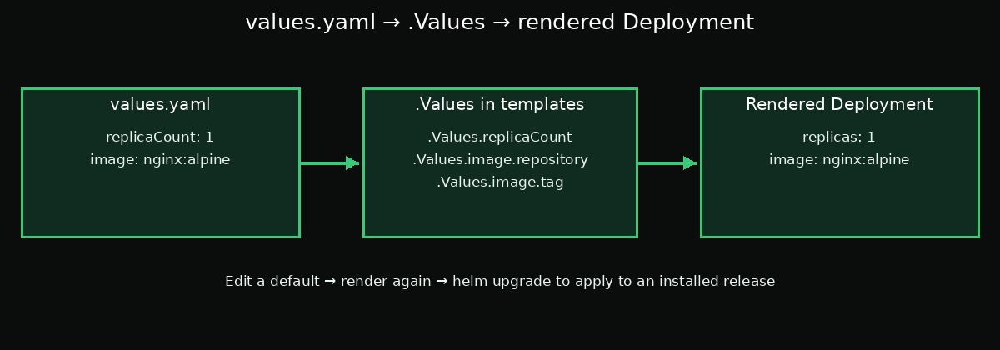

# Day 5 — Chapter 1: `values.yaml` Is the Default Configuration

> **Goal:** Understand how `values.yaml` supplies `.Values` in templates, and how changing a default affects a Helm release.

## 1. Where do `.Values` come from?

The `values.yaml` file lives in the chart directory next to `Chart.yaml`. It contains the chart's default configuration.

```yaml
replicaCount: 1
image:
  repository: nginx
  tag: alpine
```

These keys are available in templates as:

```gotemplate
{{ .Values.replicaCount }}
{{ .Values.image.repository }}
{{ .Values.image.tag }}
```



## 2. Defaults live with the chart

If an installer does not override a setting, Helm uses the chart's default. The chart author chooses which settings are configurable by referencing `.Values` in templates rather than hard-coding values.

For example, a template may use `.Values.replicaCount` to decide how many replicas the Deployment should have. If the default is `1`, the rendered Deployment uses one replica unless an override is supplied.

## 3. Changing a default is a chart change

If you change `replicaCount` from `1` to `3` in `values.yaml`, future renders use three replicas by default. Because `values.yaml` is part of the chart, this is a chart change; when publishing a new chart version, increase `version` according to your team's versioning policy.

Editing the file on disk does **not** automatically change an already-installed release. To apply the changed default to a release, upgrade it:

```bash
helm upgrade webapp /root/work/webapp -n default
```

The upgrade uses the chart's updated defaults unless overrides take precedence.

## 4. Change the default replica count

Edit the file:

```bash
vi /root/work/webapp/values.yaml
```

Change `replicaCount: 1` to:

```yaml
replicaCount: 3
```

Leave the `color` value as `blue` for this lesson.

Check the value:

```bash
grep -n '^replicaCount:' /root/work/webapp/values.yaml
```

Preview the result:

```bash
helm template webapp /root/work/webapp
```

Then upgrade the installed release:

```bash
helm upgrade webapp /root/work/webapp -n default
```

Verify the rollout:

```bash
kubectl rollout status deployment/webapp -n default --timeout=120s
kubectl get deployment webapp -n default
```

The Deployment should report three desired and ready replicas. If your chart creates a Deployment with a different name, find it with `kubectl get deployments -n default` and use its actual name.

## 5. Defaults versus overrides

- `values.yaml` defines the defaults shipped with the chart.
- User-supplied values can override those defaults.
- Templates read the resulting values through `.Values`.
- A chart change affects an installed release only when you upgrade it.

The next lesson explores ways to provide overrides without editing `values.yaml` for each environment.

## Suggested labs

Follow [`labs/README.md`](labs/README.md) for a beginner-friendly, step-by-step exercise.

## Key takeaway

`values.yaml` is the chart's default configuration. Change it when the default should change for users of the chart, and run a Helm upgrade to apply the change to an existing release.

## Official documentation

- [Values files](https://helm.sh/docs/chart_template_guide/values_files/)
- [Helm upgrade](https://helm.sh/docs/helm/helm_upgrade/)
- [Helm chart metadata](https://helm.sh/docs/topics/charts/)
