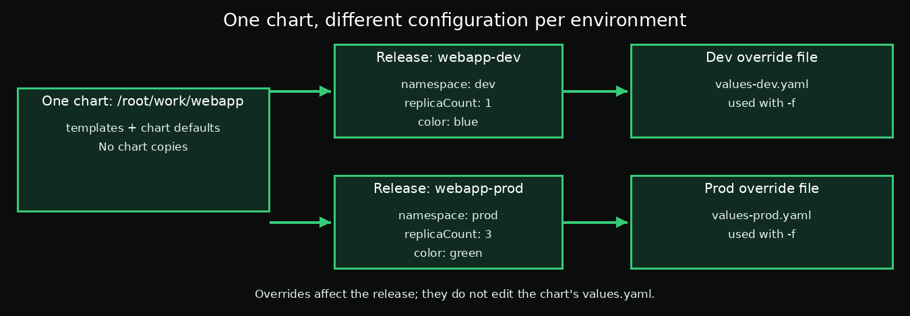

# Day 5 — Chapter 2: Overriding Values with `--set` and `-f`

> **Goal:** Learn how to change configuration for one Helm release without editing the chart's default `values.yaml`.

## 1. Why override values?

The chart's `values.yaml` defines defaults. Sometimes one installation needs a different setting—for example, a green info ConfigMap instead of blue, or three replicas in production instead of one in development.

Helm lets you provide overrides from outside the chart. The chart files remain unchanged.


## 2. Use `--set` for a quick override

For a one-time change, pass a value directly on the command line:

```bash
helm upgrade webapp /root/work/webapp \
  -n default \
  --set color=green
```

Nested values use dot notation:

```bash
helm upgrade webapp /root/work/webapp \
  -n default \
  --set image.tag=alpine
```

You can override multiple keys:

```bash
helm upgrade webapp /root/work/webapp \
  -n default \
  --set replicaCount=3 \
  --set color=green
```

These commands do not edit `/root/work/webapp/values.yaml`. Helm merges the supplied values with the chart defaults while rendering the release.

Check the stored overrides:

```bash
helm get values webapp -n default
```

To inspect the merged values including chart defaults:

```bash
helm get values webapp -n default --all
```

## 3. Use `-f` for repeatable environment settings

Create a small YAML file containing only the settings you want to override. For example, `values-prod.yaml`:

```yaml
replicaCount: 3
color: green
```

Install or upgrade using that file:

```bash
helm upgrade --install webapp-prod /root/work/webapp \
  -n prod \
  --create-namespace \
  -f /root/work/values-prod.yaml
```

Any key omitted from the override file keeps its chart default, unless another values source changes it.



## 4. Which value wins?

When the same key is set in more than one place, Helm applies the values sources in order, with later sources taking precedence. For the common sources in this lesson:

1. Chart defaults in `values.yaml`
2. Values files passed with `-f` (if multiple, later files win)
3. Command-line `--set` values

For example:

```bash
helm upgrade --install webapp-prod /root/work/webapp \
  -n prod \
  --create-namespace \
  -f /root/work/values-prod.yaml \
  --set color=purple
```

If the file says `color: green`, the command-line value wins and the release gets `purple`.

## 5. Hands-on task A: override `color` with `--set`

The chart defaults to `color: blue`, but this release needs `green`.

First confirm the default:

```bash
grep -n '^color:' /root/work/webapp/values.yaml
```

Upgrade with a command-line override:

```bash
helm upgrade webapp /root/work/webapp \
  -n default \
  --set color=green
```

Verify the ConfigMap and release values:

```bash
kubectl get configmap webapp-info -n default -o yaml
helm get values webapp -n default
```

The ConfigMap should show `color: green`, while the chart file should still show `color: blue`.

## 6. Hands-on task B: separate dev and prod releases

Create `/root/work/values-dev.yaml`:

```yaml
replicaCount: 1
color: blue
```

Create `/root/work/values-prod.yaml`:

```yaml
replicaCount: 3
color: green
```

Install each environment using the same chart:

```bash
helm upgrade --install webapp-dev /root/work/webapp \
  -n dev --create-namespace \
  -f /root/work/values-dev.yaml

helm upgrade --install webapp-prod /root/work/webapp \
  -n prod --create-namespace \
  -f /root/work/values-prod.yaml
```

Verify both releases and their resources:

```bash
helm list -A
kubectl get deployments -n dev
kubectl get deployments -n prod
helm get values webapp-dev -n dev
helm get values webapp-prod -n prod
```

Expected configuration:
- `webapp-dev`: one replica and blue
- `webapp-prod`: three replicas and green

The exact Deployment names may vary depending on the chart templates. Use the names returned by `kubectl get deployments`.

## Suggested labs

Follow [`labs/README.md`](labs/README.md) for step-by-step execution and validation.

## Key takeaway

Use `--set` for quick, one-off overrides and `-f` for reusable, reviewable environment configuration. One chart can serve many environments without copying or editing its default values.

## Official documentation

- [Values files](https://helm.sh/docs/chart_template_guide/values_files/)
- [Helm install](https://helm.sh/docs/helm/helm_install/)
- [Helm upgrade](https://helm.sh/docs/helm/helm_upgrade/)
